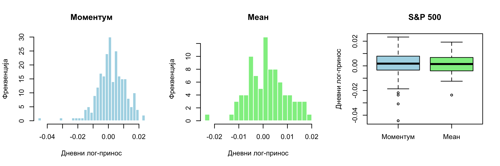

# Testing Investment Strategies in Financial Markets

### A Statistical Comparison of Momentum and Mean Reversion Strategies

**Authors:** Elena Mirković & Mila Milenić  
**Institution:** Faculty of Mathematics, University of Belgrade  
**Course:** Introduction to Statistics  
**Year:** 2026  
**Programming Language:** R

## Project Overview

This project investigates the performance of two investment strategies, **Momentum** and **Mean Reversion**, across financial markets with different levels of volatility.

The objective is to examine whether either strategy achieves statistically significantly higher daily logarithmic returns under stable or volatile market conditions.

The study combines financial time-series analysis, trading signal generation, descriptive statistics, data visualization, and statistical hypothesis testing.

## Financial Markets

The analysis covers six financial instruments, divided into two groups:

| Stable Markets | Volatile Markets |
|---|---|
| S&P 500 Index (^GSPC) | Tesla (TSLA) |
| Gold (GLD) | Nvidia (NVDA) |
| EUR/USD (EURUSD=X) | Bitcoin (BTC) |

Historical financial data was retrieved from Yahoo Finance.

## Methodology

### 1. Data Collection and Processing

Historical market prices were retrieved and processed using R and the `quantmod` package.

Daily logarithmic returns were calculated and used as the primary measure of strategy performance.

### 2. Market Volatility

Market volatility was estimated using a 20-day rolling standard deviation of logarithmic returns.

A volatility threshold was calculated from an initial reference period. This threshold was subsequently used to identify market conditions for strategy evaluation.

### 3. Investment Strategies

**Momentum**

The Momentum strategy follows the assumption that positive recent price trends may persist.

In the stable-market implementation, a trading signal is generated when the 20-day average logarithmic return is positive.

**Mean Reversion**

The Mean Reversion strategy is based on the assumption that returns may revert toward their historical average.

In the stable-market implementation, a trading signal is generated when the current logarithmic return falls below the 20-day average by more than half of the rolling standard deviation.

### 4. Statistical Hypothesis Testing

Strategy performance was evaluated using both parametric and non-parametric statistical methods:

- Welch's t-test
- Mann–Whitney U test (Wilcoxon rank-sum test)
- Paired t-test
- Wilcoxon signed-rank test

Both independent and paired comparisons were considered.

The significance level was set at **α = 0.05**.

## Data Visualization

The following figure illustrates the distributions of daily logarithmic returns generated by the Momentum and Mean Reversion strategies for the S&P 500.

It includes two histograms and a comparative boxplot, allowing visual inspection of the distributions, variability, and potential outliers.



## Key Findings

The statistical analysis did not provide sufficient evidence to establish a statistically significant performance advantage of either strategy across the examined market conditions.

Although differences in descriptive statistics were observed, they were not statistically significant at the selected significance level.

The results suggest that market volatility alone is insufficient to determine which investment strategy will perform better.

These findings are specific to the selected financial instruments, observation period, and trading rules and should not be interpreted as proof of equivalent strategy performance.

## Technologies and Skills

- **R Programming** — financial data processing and statistical analysis
- **quantmod** — historical financial data retrieval
- **Financial Time-Series Analysis** — logarithmic returns and rolling volatility
- **Statistical Hypothesis Testing** — parametric and non-parametric tests
- **Data Visualization** — histograms and boxplots
- **Quantitative Finance** — systematic investment strategy evaluation

## Repository Structure

```text
investment-strategies-statistical-analysis/
|
|-- README.md
|
|-- R/
|   |-- stable/
|       |-- S&P500_2.R
|       |-- Zlato2.R
|       |-- EUR2.R
|
|-- figures/
|   |-- sp500_provera_pretpostavki.png
|
|-- report/
    |-- investment_strategies_report.pdf
```

## Source Code

The R scripts for the stable-market analysis are available here:

- [S&P 500 Analysis](R/stable/S%26P500_2.R)
- [Gold Analysis](R/stable/Zlato2.R)
- [EUR/USD Analysis](R/stable/EUR2.R)

The scripts for the volatile-market analysis (Tesla, Nvidia, and Bitcoin) will be added later.

## How to Run the Analysis

1. Install R and optionally RStudio.
2. Install the required package in the R console:

   ```r
   install.packages("quantmod")
   ```

3. Open one of the `.R` files in the `R/stable/` directory.
4. Execute the script to retrieve historical market data, calculate logarithmic returns, generate trading signals, and perform statistical tests.

The scripts retrieve historical market data from Yahoo Finance, so an internet connection is required.

The scripts use a reference period from June 2022 to June 2023 and a testing period from June 2023 to June 2026.

## Full Academic Report

The complete research paper, including theoretical background, methodology, statistical analysis, results, and conclusions, is available below:

[Read the Full Research Report (PDF)](report/investment_strategies_report.pdf)

*The academic report is written in Serbian.*

## Authors

**Elena Mirković & Mila Milenić**  
Faculty of Mathematics, University of Belgrade

Statistics Course Project — June 2026
